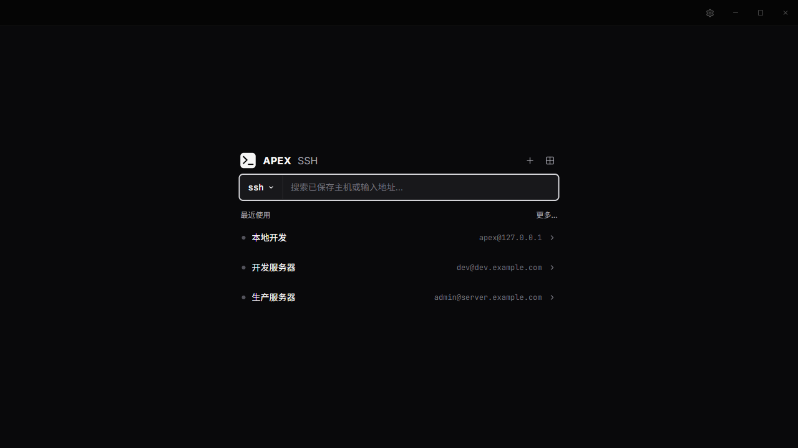

# ⚡ Apex SSH

**简洁、现代的跨平台桌面 SSH 客户端**

终端连接 · 会话管理 · SFTP 传输 · 主机监控 · 加密备份

**简体中文** | [English](README_EN.md)

以下功能与截图对应当前源码，已发布安装包的功能以对应 Release 为准。截图使用示例主机配置。

## ✨ 亮点功能

<table>
  <tr>
    <td width="50%">
      <h3>🗂 多会话工作区</h3>
      标签页同时管理多个 SSH 会话，支持左右分屏、会话复制和迁移到独立窗口。
    </td>
    <td width="50%">
      <h3>🖥 完整终端体验</h3>
      支持 ANSI 色彩、vim、方向键历史、Tab 补全、Home/End、文本选择以及复制粘贴。
    </td>
  </tr>
  <tr>
    <td width="50%">
      <h3>📁 SFTP 文件管理</h3>
      远程面板与本地/远程双栏模式，支持上传、下载、拖拽、暂停、断点续传和冲突处理。
    </td>
    <td width="50%">
      <h3>🔗 灵活的连接管理</h3>
      密码与私钥认证、主机分组和搜索、最近连接；新建连接时可从 <code>~/.ssh/config</code> 选择单个条目预填。
    </td>
  </tr>
  <tr>
    <td width="50%">
      <h3>🔐 安全凭证库</h3>
      凭证库密码和私钥口令使用系统安全存储加密；应用管理的私钥限制文件权限，界面仅获取凭证库中已保存条目的元数据。
    </td>
    <td width="50%">
      <h3>📦 备份恢复</h3>
      支持脱敏 JSON 配置备份，也可使用独立备份密码导出包含登录凭证的加密完整备份；密码可自定义或随机生成。
    </td>
  </tr>
  <tr>
    <td width="50%">
      <h3>连接启动器</h3>
      首页可搜索已保存主机、打开最近连接或输入 <code>user@host</code> 预填连接配置；选择 SFTP 后，连接成功即打开文件面板。
    </td>
    <td width="50%">
      <h3>主机监控</h3>
      通过现有 SSH 连接采集远程 Linux 主机的 CPU、内存、磁盘与网络指标，展示近期趋势，无需安装监控代理。
    </td>
  </tr>
  <tr>
    <td width="50%">
      <h3>跨设备同步</h3>
      使用自有 PostgreSQL 数据库同步主机及关联登录凭证，业务内容在本机加密后上传；真实跨设备场景仍在验收中。
    </td>
    <td width="50%">
      <h3>应用更新</h3>
      Windows 安装版可后台检查并下载更新，正常退出时安装；也可在“设置 → 关于”检查更新或重启安装。
    </td>
  </tr>
</table>

## 📥 下载

前往 [GitHub Releases](https://github.com/dunhanson/apex-ssh/releases/latest) 下载最新版本：

| 平台 | 架构 | 格式 |
| --- | --- | --- |
| 🪟 Windows | x64 / arm64 | NSIS 安装程序 |
| 🐧 Linux | x64 / arm64 | `.deb` / `.rpm` |
| 🍎 macOS | x64 / Apple Silicon | DMG |

> [!NOTE]
> 当前公开安装包尚未配置商业代码签名，首次运行时操作系统可能显示安全提示。

## 开始使用

1. 在首页点击 `+` 新建连接，填写地址、端口、用户名及密码或私钥。创建后保存配置并连接。
2. 已保存的主机可在首页搜索，或从“配置和连接”管理；成功连接后会进入最近使用列表。
3. 传输文件时，可在首页选择 `sftp` 后连接，或在会话信息栏打开 SFTP 面板。
4. 在“设置”中调整终端、界面、监控及传输偏好，或使用备份与同步。普通偏好即时保存，同步数据库参数需点击“保存连接”。

## 使用范围与数据保护

- 当前提供深色界面，语言可选跟随系统、简体中文或英文。
- SSH Config 当前用于选择单个条目预填，不支持批量导入或 ProxyJump 多跳连接。
- 脱敏备份不包含登录凭证；完整备份包含可迁移凭证，需要独立备份密码。请妥善保管备份文件和密码。
- 系统安全存储保护的是凭证库密码、已保存的私钥口令等数据；直接填写在主机配置中的密码仍可能保存在本地配置文件中。
- 云同步需自行准备 PostgreSQL 数据库，并在各设备配置相同的数据库参数与同步密钥。同步不包含应用偏好、最近连接、传输文件或未被主机引用的凭证；独立分组与排序也不单独同步。
- 当前同步数据库连接未启用 TLS，业务内容加密不能保护数据库认证流量。同步密钥无找回入口，更换密钥会影响其他设备；“清空云端”后，保留的本地记录仍可能再次上传。
- 应用内更新仅支持 Windows 安装版；macOS、Linux 需从 Releases 下载新版本。开发环境中的 Windows 版本仅支持手动检查，不下载或安装。

## 🛠 技术概览

主进程负责 SSH、SFTP、凭证与本地数据，渲染进程通过受限 IPC 接口访问这些能力。

## 📖 文档

- [开发指南](docs/开发指南.md)
- [构建与发布指南](docs/发布指南.md)
- [参与贡献](CONTRIBUTING.md)
- [安全策略](SECURITY.md)

## 📄 许可证

本项目使用 [MIT License](LICENSE)。
